# Qt-Examples

-   [Simplified Chinese](README.md)
-   [English](README.en.md)

## Overview

This repository contains a rich collection of Qt sample projects, covering a variety of functions from basic UI components to advanced network programming and system tools. Each example is self-contained and can be used as a reference or starting point for development of your Qt projects.

## Table of contents

-   [UI controls](#ui-控件)
-   [data visualization](#数据可视化)
-   [Tools and Systems](#工具与系统)
-   [Network and Database](#网络与数据库)
-   [Package deployment](#打包部署)
-   [resource](#资源)

## UI controls

### [Battery](src/Battery/)-Battery power display control

-   Supports charging status display and lightning symbol
-   Low battery alarm threshold and color can be set
-   Support numerical animation transition effects

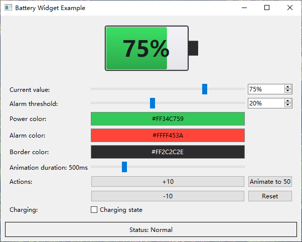

> **QtQuick version**：[BatteryQuick](src/BatteryQuick/)- Battery level display control (QtQuick version)
>
> 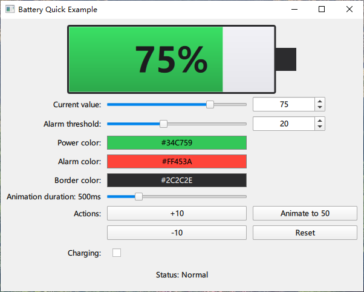

### [Bubble](src/Bubble/)- Bubble dialog control

-   Support arrow positioning in four directions
-   Contains fade animation and shadow effects
-   Customizable borders, background colors and rounded corners

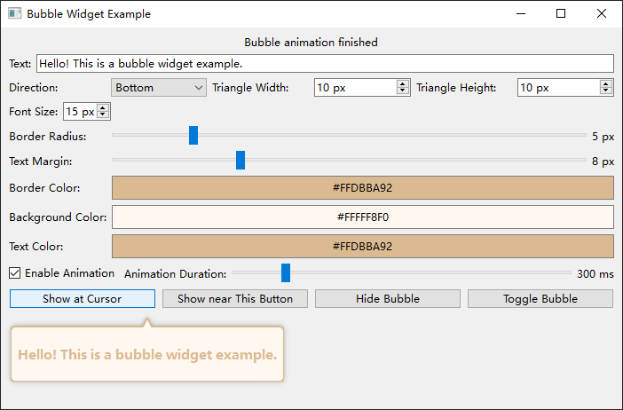

### [ButtonIconStateManager](src/ButtonIconStateManager/)- Button icon state manager

-   Smart management button icon switching in different states
-   Supports four states: normal, hover, pressed, and selected.
-   Automatic status detection based on event filters
-   Can be applied to QPushButton, QToolButton and other button types

### [Carousel3DView](src/Carousel3DView/)- 3D carousel control

-   Supports image carousel display with stereoscopic 3D effect
-   Customizable animation duration and automatic rotation interval
-   Automatic carousel is paused when the mouse is hovered and resumed when removed.
-   Support clicking on the picture to jump directly to the center location

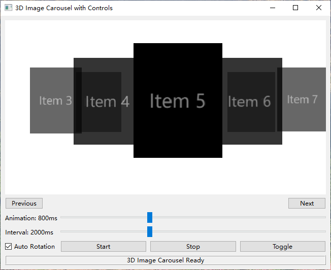

### [Clock](src/Clock/)- Analog clock control

-   Support second hand smooth animation effect
-   Customizable dial, scale, and pointer colors
-   Provides a variety of preset color themes

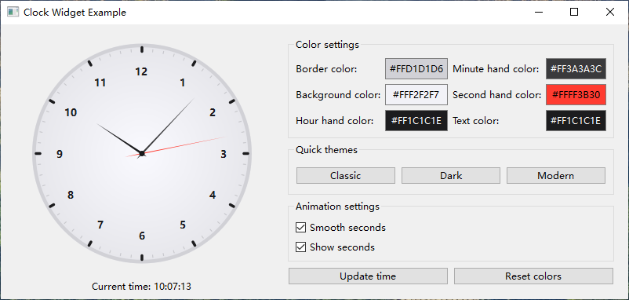

> **QtQuick version**：[ClockQuick](src/ClockQuick/)- Analog clock control (QtQuick version)
>
> 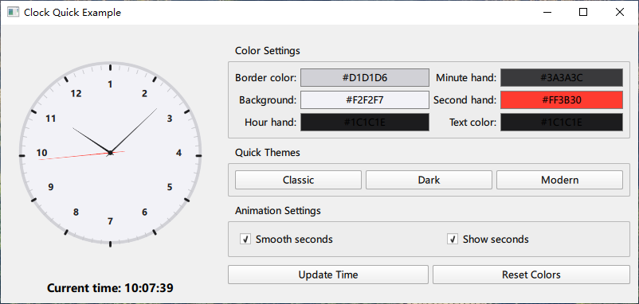

### [DashBoard](src/DashBoard/)- Dashboard controls

-   Adjustable scale range and angle range
-   Support pointer numerical animation transition
-   Highly customizable colors and text styles

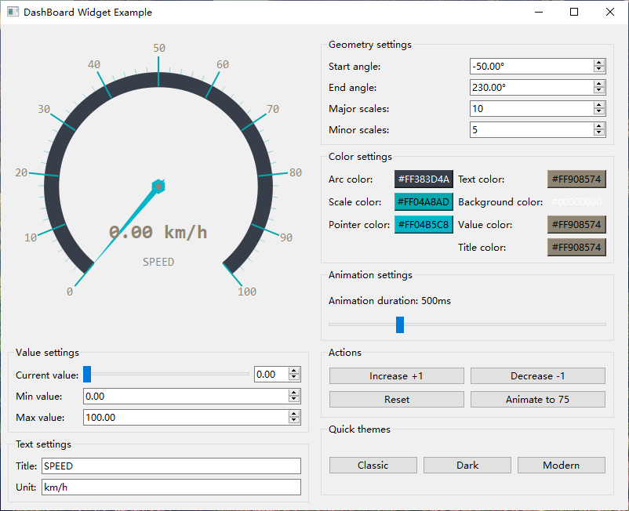

> **QtQuick version**：[DashBoardQuick](src/DashBoardQuick/)- Dashboard control (QtQuick version)
>
> 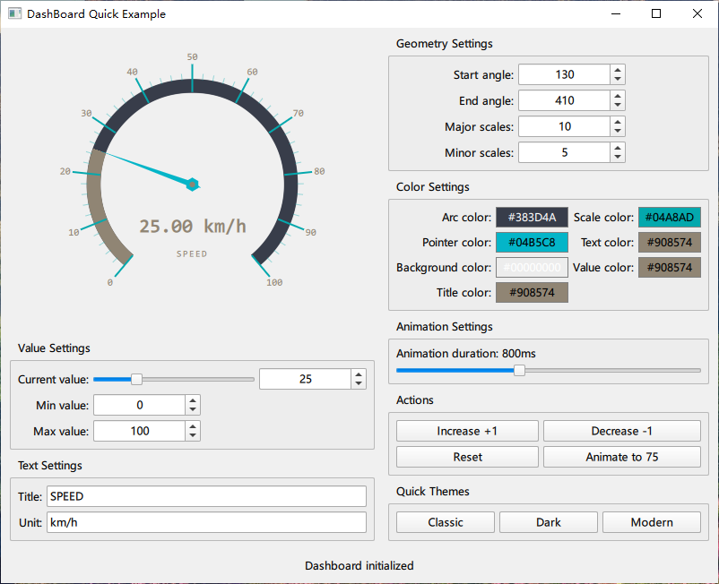

### [LoadingIndicator](src/LoadingIndicator/) - 加载指示器控件

-   Supports multiple animation styles: rotating dots, pulsing circles, jumping bars, custom GIF animations
-   Customizable text, color, background and animation speed
-   Provide overlay mode to easily achieve mask loading effect

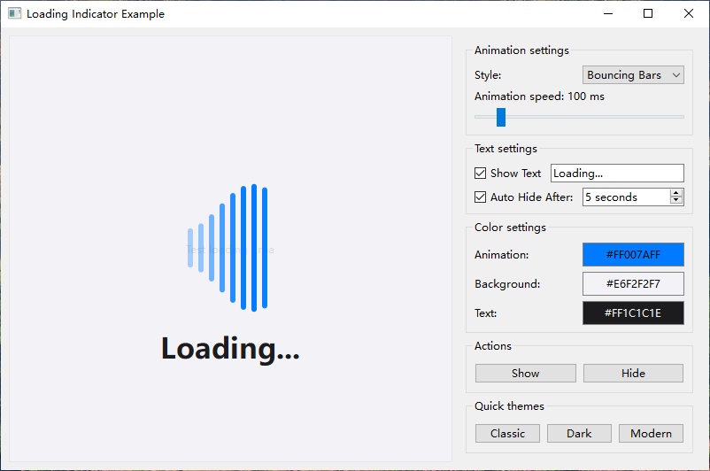

> **QtQuick version**：[LoadingIndicatorQuick](src/LoadingIndicatorQuick/)- Loading indicator control (QtQuick version)
>
> 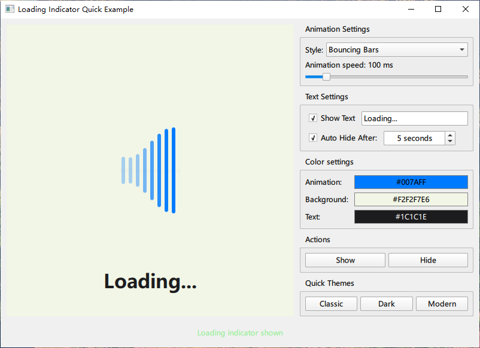
>
> **Related controls**：[LoadingOverlayQuick](src/LoadingOverlayQuick/)- Loading overlay control (QtQuick version) - lightweight loading overlay component based on QtQuick Popup, using the system's native BusyIndicator, modal dialog design
>
> 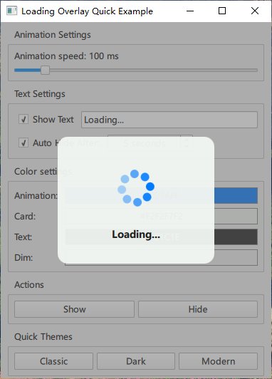

### [NavigationProgressBar](src/NavigationProgressBar/)- Navigation progress bar control

-   Supports visual display of multi-step processes
-   Customizable color themes and font styles
-   Provide step forward, backward and reset functions

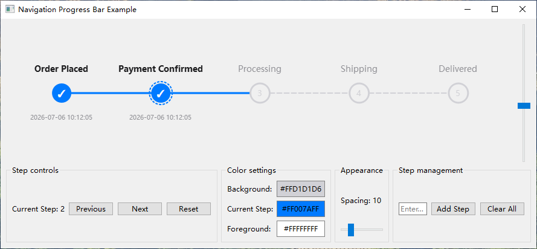

### [PasswordLineEdit](src/PasswordLineEdit/)- Password input box control

-   Support show/hide password switching function
-   Automatically detect CapsLock status and display warning prompts
-   Customizable icons, prompt duration and warning functions

> **QtQuick version**：[PasswordInputQuick](src/PasswordInputQuick/)- Password input box control (QtQuick version)

### [ProgressBar](src/ProgressBar/)- Linear progress bar control

-   Supports animation transition effects and can customize the animation duration
-   Customizable fillet radius, supports automatic fillet calculation
-   Supports two display modes: percentage and numerical value

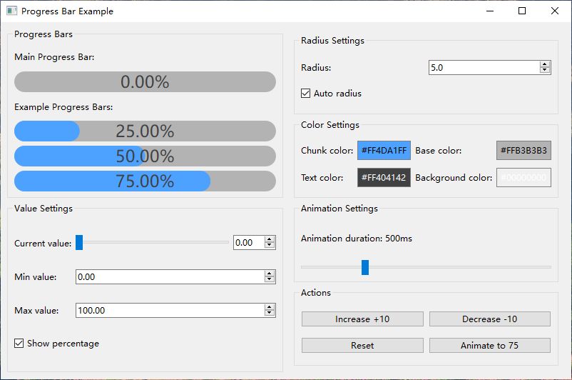

### [SwitchButton](src/SwitchButton/) - 开关按钮控件

-   Supports smooth switch animation transition effects
-   Customizable colors for selected and unselected states
-   Customizable slider color and border color

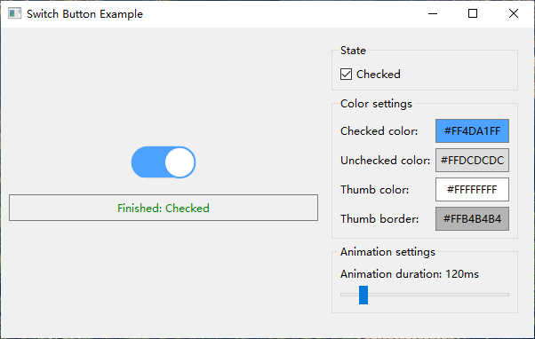

> **QtQuick version**：[SwitchDelegate](https://doc.qt.io/qt-6/zh/qtquickcontrols-customize.html#customizing-switchdelegate)- Qt official switch button delegate (QtQuick version)

## data visualization

### [Chart](src/Chart/)- Data visualization charts (QtCharts module)

-   Multiple chart types: area chart, line chart, pie chart, bar chart
-   Real-time dynamic charts
-   Custom callouts and tooltips

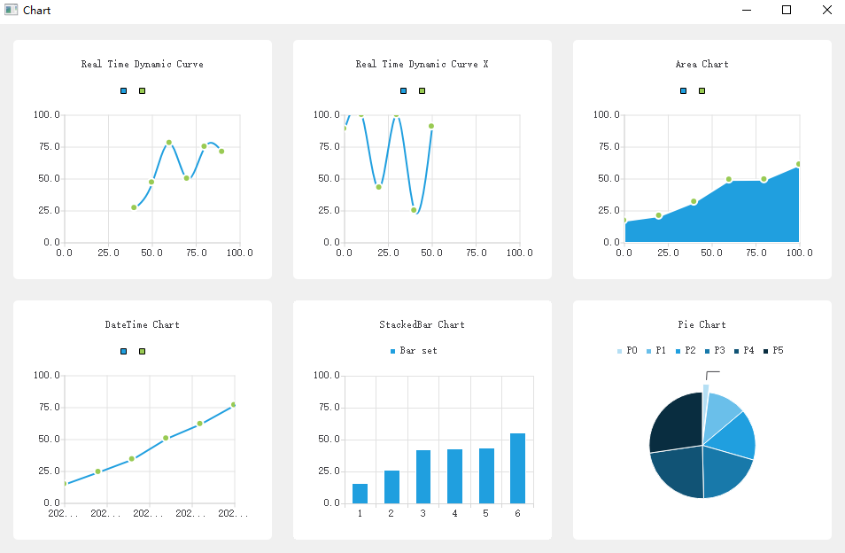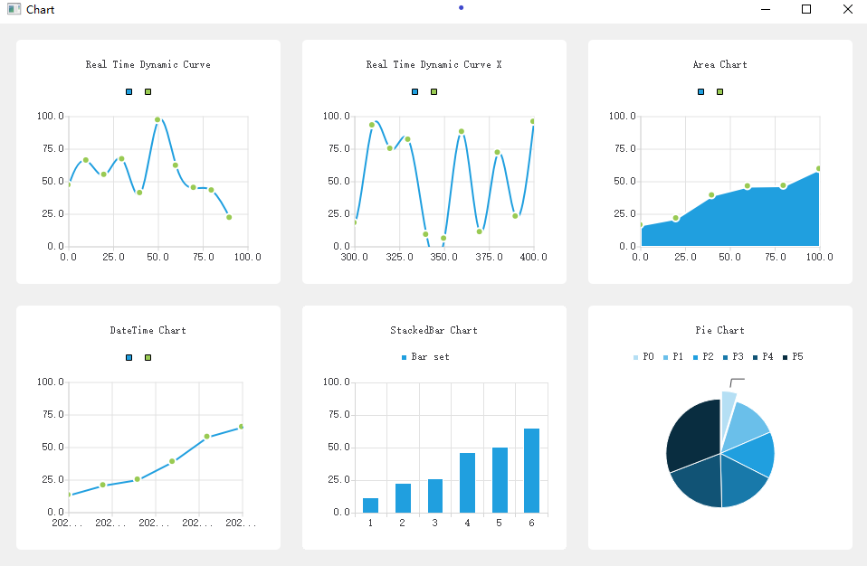

### [CircularProgress](src/CircularProgress/)- Circular progress bar control

-   Support arc progress display and percentage/numeric display
-   Customizable starting and ending angles
-   Supports animated transition effects and multiple color customizations
-   Provides rich signal and slot functions for status monitoring

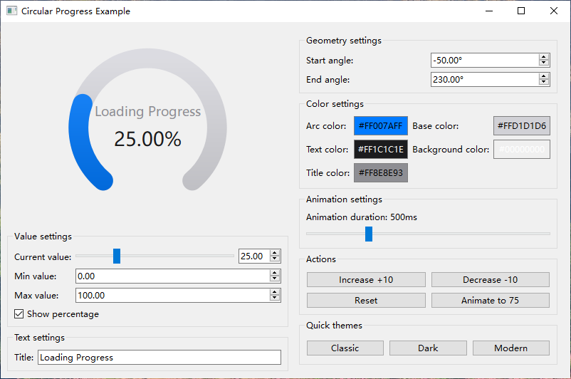

> **QtQuick version**：[CircularProgressQuick](src/CircularProgressQuick/)- Circular progress bar control (QtQuick version)
>
> 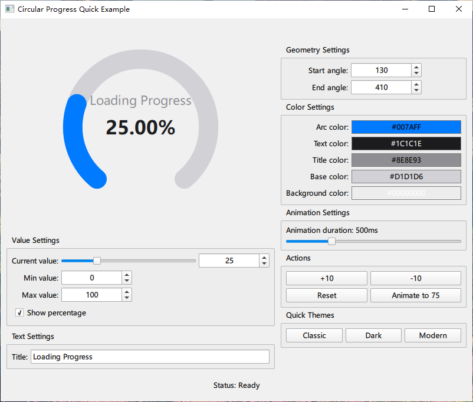

### [CheckableTreeItem](src/CheckableTreeItem/)- Hierarchical checkbox tree

-   The check box status of parent and child nodes is automatically linked
-   Support three-state display (selected/unselected/partially selected)
-   Contains file system tree structure demonstration

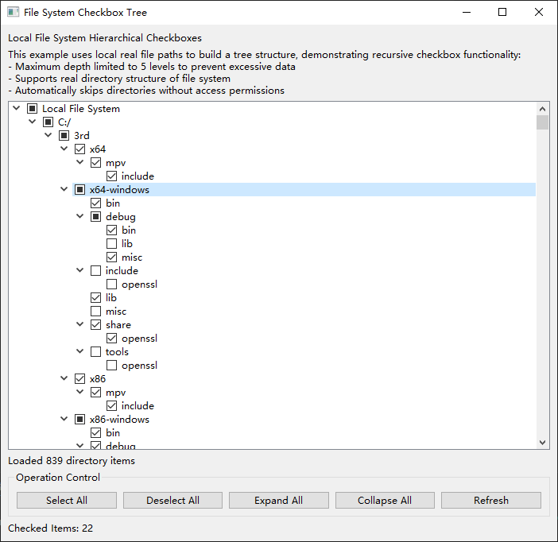

### [GridViewModel](src/GridViewModel/)- Adaptive grid layout

-   Grid layout component based on Qt Model-View architecture
-   Support adaptive column number and custom cells
-   Built-in multi-selection function and smooth interactive experience

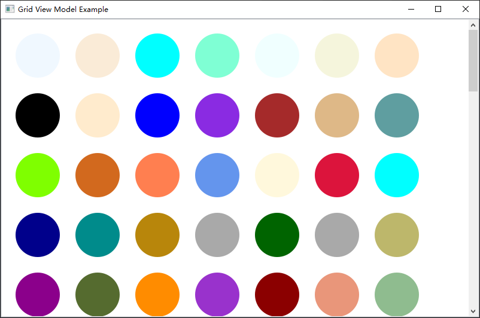

## Tools and Systems

### [AsyncLog](src/AsyncLog/)- Asynchronous logging system

-   Take over Qt global log (qDebug/qInfo/qWarning/...), any thread calls zero changes; QObject singleton facade,`batchReady`Batch signals can be connected to make UI real-time log view
-   Double-buffered MPSC queue + dedicated back-end thread batch placement: O(1) enqueuing on the production side, second-level timestamp caching
-   Hierarchical saturation strategy: instantaneous spikes are waiting to be digested, continuous overload only discards DEBUG/INFO and counts supplementary reports, and WARNING and above will never be discarded
-   Roll by day + size, file name contains host name and process ID (`<app>_<host>_<pid>_<时间>.log`), expired cleanup only deletes files with their own naming pattern
-   `QtFatalMsg`Return Qt after synchronous placement and terminate;`shutdown`Empty the queue to ensure no logs are lost
-   Unit test-ready usage examples: coverage level filtering, rolling, clean-safe, saturation, draining, fatal, signaling and throughput benchmarks

### [AutoStartManager](src/AutoStartManager/)- Auto-start management at boot

-   **Windows**:User registration form`HKEY_CURRENT_USER\SOFTWARE\Microsoft\Windows\CurrentVersion\Run`, system registry`HKEY_LOCAL_MACHINE\...\Run`
-   **macOS**：`~/Library/LaunchAgents/com.{appname}.plist`
-   **Linux**：`~/.config/autostart/{appname}.desktop`

### [LifecycleCallback](src/LifecycleCallback/)- Lifecycle aware callback wrapper

-   Automatically detect object destruction and avoid dangling callbacks
-   Supports QObject, std::shared_ptr and free functions
-   Type safety, providing convenient creation of functions

### [WindowsIntegration](src/WindowsIntegration/)- Windows "This PC" integration

-   **Windows**:registry`HKEY_CURRENT_USER\SOFTWARE\Classes\CLSID\{GUID}`and`HKEY_CURRENT_USER\SOFTWARE\Microsoft\Windows\CurrentVersion\Explorer\MyComputer\NameSpace\{GUID}`
-   **Function**: Adds an application icon to Windows This PC, displaying it alongside the disk drive

## Network and Database

### [HttpClient](src/HttpClient/)- HTTP client

-   Chain API:`client.get(url).timeout(30s).bearer(token).onFinished(...).send()`Asynchronously initiated (returns cancelable`HttpTask`, discard the handle (i.e. fire-and-forget),`sync()`Synchronous blocking returns directly`HttpResult`
-   The general layer covers arbitrary verbs and payloads:`method("PROPFIND")`+`body(xml, "application/xml")`;JSON is a convenience layer (`post(url, obj)`Entry serialization,`HttpResult::json`Response pre-parsing)
-   Inherit QNetworkAccessManager, the connection pool/proxy/Cookie native capabilities are available; Basic credentials are registered by host, automatically respond to 401 challenges and do not leak across hosts
-   download write`.temp`After success, change the name and press`.temp`Offset automatic Range breakpoint resume, read buffer back pressure`readBufferLimit`;Upload supports original body (file streaming does not occupy memory/memory) and multipart
-   Timeout control, SSL error handling,`onFinished`/`onProgress`Life cycle safety callback (automatically invalidated when the receiving object is destroyed)
-   Protocol encapsulation extension points:`createRequest()`(requesting side) with`resultReady()`(response side), covering all request paths - WebDavClient is built on this

### [WebDavClient](src/WebDavClient/)- WebDAV client (RFC 4918)

-   Directly inherit HttpClient (WebDAV is the verb/header/XML vocabulary extension of HTTP, no new transmission behavior), session mechanisms such as timeout/cancellation/authentication/breakpoint resume are inherited and used immediately
-   vocabulary factory`propfind`/`mkcol`/`copy`/`move`/`options`/`lock`/`unlock`Only the default verb/head/body is set, and the calls on the chain can be overridden item by item.
-   `check()`One call completion response determination: success/failure, readable reason,`DavErrorCode`Classification, and 207 multistatus per-resource status (PROPFIND payload/COPY, MOVE partial failure details and counts)
-   Parsing strictly follows RFC 4918: propstat standard order (attribute temporary storage, only 2xx merged),`DAV:`Namespace URI matching, href relative resolution with percent encoding preserved, HTTP date (IMF-fixdate)
-   Lock token table:`lock()`Automatically enter the table successfully (before user callback), and modify the class request to automatically carry`If`header (explicit settings take precedence),`unlock()`Automatically pick up the table`Lock-Token`;Cross-process recovery`rememberLock()`
-   Three-layer testing: No network branch matrix / Flask fault injection (partial failure 207, malformed XML, status code injection) / WsgiDAV real server compliance verification (including real lock manager)

### [ReactorServer](src/ReactorServer/)- Multi-threaded Reactor mode TCP server

-   High-performance TCP server framework based on Reactor design pattern
-   Master-slave Reactor architecture: the main thread accepts connections and the worker thread handles I/O
-   Built-in thread pool and load balancing, automatically assign connections to idle threads

### [SqliteWAL](src/SqliteWAL/)- SQLite write-ahead log

-   Multi-threaded SQLite database operations
-   WAL mode implementation
-   Thread-safe write operations

## Package deployment

### [FlowLayout](https://doc.qt.io/qt-6/qtwidgets-layouts-flowlayout-example.html)- Qt official Flow Layout Example

## resource

-   [Qt Practical Tips (Chinese)](https://realchuan.github.io/2021/10/12/QT实用小技巧（想到就更新）/)
-   [Use QChart to display real-time dynamic curves](https://qtdebug.com/qtbook-paint-realtime-curve-qchart/)
-   [SQLite WAL documentation](https://sqlite.org/wal.html)
